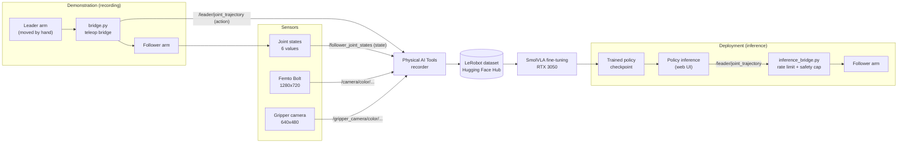

# Physical AI with SmolVLA on the SO-ARM101

**End-to-end imitation learning on a low-cost robot arm:** leader–follower teleoperation, two-camera data collection over ROS 2, LeRobot datasets on Hugging Face, and fine-tuning of the SmolVLA vision-language-action model for a real pick-and-place task.


-yellow)


> **Honest status (October 2026).** The full data → training → inference pipeline runs end to end. The trained model reproduces the demonstrations offline and, on the real robot, drives the arm to the cube and positions the gripper above it. **A complete, successful pick-and-place on the physical robot has not yet been achieved or measured.** Every claim in this repository is labelled by evidence level; see [VERIFICATION_STATUS.md](VERIFICATION_STATUS.md).

---

## Table of contents

1. [Motivation and problem statement](#motivation-and-problem-statement)
2. [Objectives](#objectives)
3. [Hardware](#hardware)
4. [Software stack](#software-stack)
5. [Architecture overview](#architecture-overview)
6. [Workflows](#workflows)
7. [Current status and verified results](#current-status-and-verified-results)
8. [Dataset and model links](#dataset-and-model-links)
9. [Quick start](#quick-start)
10. [Documentation map](#documentation-map)
11. [Learning resources and research](#learning-resources-and-research)
12. [Limitations and future work](#limitations-and-future-work)
13. [Author](#author)

---

## Motivation and problem statement

Classical robot programming needs an engineer to specify every waypoint, grasp and recovery behaviour. **Imitation learning** replaces that with demonstrations: a person performs the task, the robot records what it saw and what it did, and a neural network learns the mapping from observations to actions. **Vision-language-action (VLA) models** take this further by building on a pretrained vision-language model, so the policy can be conditioned on a camera view *and* a natural-language instruction.

Most published VLAs have billions of parameters and are trained on expensive robots. This project asks a practical question:

> *Can a small, open VLA (SmolVLA, ~450M parameters) be fine-tuned on a few dozen self-collected demonstrations, on a 6 GB consumer GPU, to perform a real pick-and-place task on a low-cost SO-ARM101 arm?*

## Objectives

| # | Objective | Status |
|---|-----------|--------|
| O1 | Bring up a leader–follower SO-ARM101 with reliable motor communication | ✅ Done |
| O2 | Stream two cameras (scene + gripper) into ROS 2 with stable device naming | ✅ Done |
| O3 | Record a LeRobot dataset of pick-and-place demonstrations and publish it | ✅ Done (39 episodes) |
| O4 | Fine-tune SmolVLA locally on an RTX 3050 | ✅ Run 1 complete (20k steps); Run 2 status not verified |
| O5 | Verify the model offline against recorded demonstrations | ✅ Done for Run 1 (qualitative, episode 0) |
| O6 | Execute the policy on the real robot | 🟡 Reported: performs pick and place (success rate not measured) |
| O7 | Measure real-world success rate with a repeatable protocol | ⏳ Planned ([protocol](docs/evaluation.md)) |

## Hardware

| Component | Details |
|-----------|---------|
| Robot | SO-ARM101 leader + follower, 6 joints each: `shoulder_pan`, `shoulder_lift`, `elbow_flex`, `wrist_flex`, `wrist_roll`, `gripper` |
| Servos | 12 × Feetech STS3215 on a 1 Mbps serial bus |
| Motor interfaces | 2 × CH34x USB–serial boards (USB ID `1a86:55d3`) |
| Scene camera | Orbbec Femto Bolt, colour stream at 1280×720 |
| Gripper camera | USB UVC camera ("HZ"), 640×480, mounted on the gripper |
| Compute | Ubuntu PC (MSI MS-7C95), NVIDIA GeForce RTX 3050 6 GB |

Details: [docs/hardware-setup.md](docs/hardware-setup.md).

## Software stack

| Layer | Container stack (recording, Run 1 training, web-UI inference) | Host stack (Run 2 training, planned rollout) |
|-------|------------------------------|-------------------------------|
| OS / middleware | ROS 2 Jazzy, `rmw_zenoh_cpp`, `ROS_DOMAIN_ID=30` | Ubuntu, no ROS required |
| Robot learning | LeRobot (version bundled with ROBOTIS Physical AI Tools; dataset format v2.1) | LeRobot **0.6.2** (dataset format v3.0) |
| Framework | PyTorch (container build) | PyTorch **2.11.0+cu130**, Python 3.12 |
| Interface | ROBOTIS **Physical AI Tools** web UI (`http://localhost`) | CLI: `lerobot-train`, `lerobot-rollout` |
| Packaging | Docker (`physical_ai_server`, `physical_ai_manager`, `open_manipulator`) | Conda env `lerobot` |

Details: [docs/software-setup.md](docs/software-setup.md).

## Architecture overview



The policy-level data flow:

```
Camera observations (scene + gripper) + language instruction + joint state (6)
                                  │
                                  ▼
             SmolVLA  (SmolVLM-2 backbone + flow-matching action expert)
                                  │
                                  ▼
          Action chunk: 50 future joint-position targets (6 values each)
                                  │
                                  ▼
        inference_bridge.py  (goal rate-limiting, distance cap, hold-on-timeout)
                                  │
                                  ▼
                      SO-ARM101 follower (Feetech servos)
                                  │
                                  ▼
          Physical pick-and-place  — currently: reach ✅, grasp ❌, place ❌
```

All diagrams, with explanations: [docs/system-architecture.md](docs/system-architecture.md) and [architecture/](architecture/).

## Workflows

| Workflow | What happens | Document |
|----------|--------------|----------|
| Leader–follower teleoperation | `bridge.py` reads the leader, mirrors it to the follower and publishes state + action topics | [docs/teleoperation.md](docs/teleoperation.md) |
| Camera pipeline | `start_cameras.sh` launches `v4l2_camera` nodes by stable device path; `find_femto.sh` locates the Femto Bolt colour node | [docs/camera-integration.md](docs/camera-integration.md) |
| Dataset collection | Physical AI Tools records synchronized topics at 30 fps into a LeRobot v2.1 dataset and pushes it to the Hub | [docs/dataset-recording.md](docs/dataset-recording.md) |
| Training | SmolVLA fine-tuning in the container (Run 1) and on the host with LeRobot 0.6.2 (Run 2) | [docs/smolvla-training.md](docs/smolvla-training.md) |
| Inference | Policy publishes actions; `inference_bridge.py` turns them into safe servo goals | [docs/inference.md](docs/inference.md) |
| Evaluation | Offline action-replay comparison now; real-robot trial protocol planned | [docs/evaluation.md](docs/evaluation.md) |

## Current status and verified results

| Area | Evidence level | Result |
|------|----------------|--------|
| Hardware | ✅ Tested | All 12 motors respond; mirroring works; both cameras stream at 30 Hz |
| Dataset | ✅ Verified from Hub metadata | 39 episodes, 23,424 frames, 30 fps, 2 cameras, 6-D state and action |
| Run 1 training (container) | ✅ Verified from checkpoint listing and config dump | 20,000 steps completed; checkpoints every 2,000 steps; `last -> 020000` |
| Run 1 loss | 🟡 Reported, log not archived here | ≈ 0.04 near the end of training |
| Run 1 offline check | 🟡 Reported, script output not archived here | Predictions within ≈ 2–5 units of recorded actions on every joint for episode 0; phase timing matched |
| Run 2 training (host, LeRobot 0.6.2) | 🟡 Partially verified | Started; ≈ 0.53 s/step, ≈ 2.5 GB GPU, loss ≈ 0.09 at step 7,500; completion **not verified** |
| Real-robot inference | 🟡 Reported | Pick and place performed on the real robot (author-reported); success rate not yet measured |
| Real-world success rate | ❌ Not measured | — |

> **Training loss is not task success.** A loss of 0.04 means the model imitates the recorded actions well *on the training distribution*. It says nothing about closed-loop behaviour when small errors compound, lighting changes, or extra objects appear. See [learning/evaluation-metrics.md](learning/evaluation-metrics.md).

Full experiment record: [experiments/experiment-log.md](experiments/experiment-log.md).

## Dataset and model links

| Resource | Link | Verified |
|----------|------|----------|
| Main dataset | [NandithaaaG/s101_dataset_pick_and_place](https://huggingface.co/datasets/NandithaaaG/s101_dataset_pick_and_place) | ✅ Public, LeRobot v2.1, Apache-2.0 |
| Earlier dataset (ACT experiments) | [NandithaaaG/grab_place_training](https://huggingface.co/datasets/NandithaaaG/grab_place_training) | ✅ Public, 20 episodes; link to this project's pipeline not verified |
| Base model | [lerobot/smolvla_base](https://huggingface.co/lerobot/smolvla_base) | ✅ Official |
| Fine-tuned models | — | ❌ Not published (no public models on the account) |

Details: [docs/dataset-structure.md](docs/dataset-structure.md).

## Quick start

> Commands are labelled **[HOST]** (Ubuntu shell) or **[CONTAINER]** (inside the Physical AI Tools Docker container). Never paste a Hugging Face token into a file; use `hf auth login` or the `HF_TOKEN` environment variable.

```bash
# [HOST] 1. Check the environment (GPU, PyTorch, LeRobot, SmolVLA import)
conda activate lerobot
python scripts/verify_environment.py

# [HOST] 2. Download the dataset and inspect it
hf download NandithaaaG/s101_dataset_pick_and_place --repo-type dataset \
  --local-dir ~/.cache/huggingface/lerobot/NandithaaaG/s101_dataset_pick_and_place
python scripts/inspect_dataset.py ~/.cache/huggingface/lerobot/NandithaaaG/s101_dataset_pick_and_place

# [HOST] 3. Enter the Physical AI Tools container
cd ~/lerobot/physical_ai_tools/docker && ./container.sh enter
```

Step-by-step tutorials: [tutorials/](tutorials/).

## Documentation map

Recommended reading order is in [docs/index.md](docs/index.md).

| Folder | Contents |
|--------|----------|
| [docs/](docs/) | Implementation documentation: setup, pipeline, training, inference, troubleshooting |
| [tutorials/](tutorials/) | Numbered, runnable walkthroughs |
| [learning/](learning/) | Concept guides: physical AI, VLAs, imitation learning, action chunking, evaluation |
| [research/](research/) | Paper summaries, literature review, comparison table, BibTeX |
| [experiments/](experiments/) | Experiment log, training configurations, evaluation templates, lessons learned |
| [architecture/](architecture/) | Mermaid source for every diagram |
| [scripts/](scripts/) | Environment check, dataset inspector, link checker, secret scanner |
| [VERIFICATION_STATUS.md](VERIFICATION_STATUS.md) | What is verified, reported or missing; files you still need to add |
| [PUBLISHING.md](PUBLISHING.md) | Exact Git and GitHub commands to publish this repository |

## Learning resources and research

The [learning path](learning/README.md) runs from physical-AI fundamentals to real-world evaluation. Key papers (full list in [research/references.bib](research/references.bib)):

- Shukor et al., *SmolVLA* (2025), arXiv:2506.01844 — the model used here
- Cadene et al., *LeRobot* (ICLR 2026), arXiv:2602.22818 — the library used here
- Zhao et al., *ACT / ALOHA* (RSS 2023), arXiv:2304.13705 — action chunking
- Chi et al., *Diffusion Policy* (RSS 2023), arXiv:2303.04137
- Brohan et al., *RT-1* (RSS 2023) and *RT-2* (CoRL 2023)
- Kim et al., *OpenVLA* (CoRL 2024); Black et al., *π0* (2024)
- Kress-Gazit et al., *Robot Learning as an Empirical Science* (2024) — evaluation practice

## Limitations and future work

**Current limitations:** single task and single instruction; 39 episodes (below the ~50 recommended by the SmolVLA guide); small training batch forced by 6 GB of GPU memory; test-time conditions did not match recording conditions (extra cubes, gripper-camera auto white balance); no measured success rate. Full list: [docs/limitations-and-future-work.md](docs/limitations-and-future-work.md).

**Next steps:** match inference conditions to training, record 10–20 more episodes with fixed camera settings and systematic cube positions, compare against an ACT baseline, run the [evaluation protocol](docs/evaluation.md), and move the arm adapters off the unstable USB hub chain.

## Author

**Nanditha G** — [Hugging Face: NandithaaaG](https://huggingface.co/NandithaaaG)

If you use this documentation, please cite it using [CITATION.cff](CITATION.cff). The underlying tools belong to their authors: [LeRobot](https://github.com/huggingface/lerobot) (Hugging Face), [Physical AI Tools](https://github.com/ROBOTIS-GIT/physical_ai_tools) (ROBOTIS), and the [SO-ARM100/101](https://github.com/TheRobotStudio/SO-ARM100) design (TheRobotStudio).

License: [MIT](LICENSE) for code and documentation in this repository. Datasets and models on Hugging Face carry their own licences.
