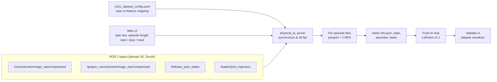

# Dataset Recording

## Contents
- [Diagram D: recording pipeline](#diagram-d-recording-pipeline)
- [Robot configuration](#robot-configuration)
- [Recording workflow](#recording-workflow)
- [Recording checklist](#recording-checklist)
- [Validation after recording](#validation-after-recording)
- [Recorded datasets](#recorded-datasets)
- [Recommendations for the next recording session](#recommendations-for-the-next-recording-session)

## Diagram D: recording pipeline

## Robot configuration

Physical AI Tools reads a robot configuration that maps ROS topics to LeRobot features. The project's file is `s101_dataset_config.yaml` (the file itself is not included yet). Its verified mapping:

| LeRobot feature | Source topic | Shape |
|-----------------|--------------|-------|
| `observation.images.global` | `/camera/color/image_raw/compressed` | 720×1280×3 |
| `observation.images.gripper` | `/gripper_camera/color/image_raw/compressed` | 480×640×3 |
| `observation.state` | `/follower_joint_states` | 6 |
| `action` | `/leader/joint_trajectory` | 6 |

The resulting dataset has `robot_type: "s101_dataset"`. The config name became the robot type, and the dataset repo name carries the same `s101_dataset_` prefix, which caused a "dataset not found" error when a repo ID without the prefix was used.

## Recording workflow

1. Start the container, the cameras (`~/start_cameras.sh`) and `bridge.py`.
2. Confirm all four topics are publishing (`ros2 topic hz ...`).
3. Open the web UI at `http://localhost`, select the robot configuration, and set:
   - the **task instruction** (the same string for every episode),
   - the dataset repo ID (`NandithaaaG/s101_dataset_pick_and_place`),
   - episode duration and reset time.
4. For each episode: place the cube, start the arm from the rest pose, start recording, demonstrate the pick-and-place with the leader, return to rest, stop.
5. Push to the Hugging Face Hub when done.

Episode length in the final dataset averages **600.6 frames ≈ 20.0 s** (23,424 frames ÷ 39 episodes ÷ 30 fps).

## Recording checklist

| Before each session | Why |
|---------------------|-----|
| Lock camera exposure and white balance | Prevents colour drift between sessions and at inference |
| Use the same lighting | Same reason |
| Remove distractor objects (extra cubes) | The policy may target the wrong object |
| Keep the camera mounts fixed | A moved camera is a new viewpoint for the policy |
| Use the same rest pose | The first observation of every episode should look the same |

| During the session | Why |
|--------------------|-----|
| Vary cube position systematically (several demos per position) | The SmolVLA guide recommends enough demonstrations per variation |
| Discard failed or hesitant demonstrations | Bad demonstrations teach bad behaviour |
| Log the cube and tray position for each episode | Needed later for in- versus out-of-distribution evaluation |

## Validation after recording

The 21-episode dataset was validated in the [LeRobot dataset visualizer](https://huggingface.co/spaces/lerobot/visualize_dataset):

- ✅ Both camera streams present and **not swapped**.
- ✅ All six joints present in state and action.
- ✅ State follows action, with the expected small lag of a follower tracking a leader.

The 39-episode dataset can be opened the same way: [visualize episode 0](https://huggingface.co/spaces/lerobot/visualize_dataset?path=/NandithaaaG/s101_dataset_pick_and_place/episode_0).

## Recorded datasets

| Dataset | Episodes | Frames | Status |
|---------|----------|--------|--------|
| `NandithaaaG/s101_dataset_pick_and_place` | 39 | 23,424 | ✅ Public, verified; used for training |
| `nanditha123/s101_dataset_SO101_Pick_and_Place` | 21 | — | 🟡 Reported and validated in the viewer; not publicly findable now |
| `NandithaaaG/grab_place_training` | 20 | 29,917 | ✅ Public; earlier ACT-oriented dataset with front + side cameras at 640×480, `robot_type: so_follower` |

## Recommendations for the next recording session

Based on the inference failures and the SmolVLA guide (which recommends about 50 episodes and enough demonstrations per variation; the authors report that a 25-episode version of their pick-place dataset was not enough), see the [SmolVLA docs](https://huggingface.co/docs/lerobot/smolvla):

1. Record **10–20 more episodes** with locked gripper-camera white balance.
2. Use a **grid of cube positions** (for example 5 positions × 4 demos) and log which position each episode used.
3. Keep **one cube** in the scene, as at inference.
4. Keep episodes **≥ 20 s**, the same length used at inference.
5. Consider a separate dataset with deliberate distractors once the clean task works.
