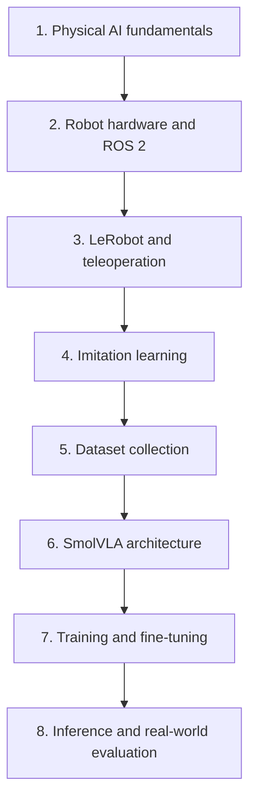

# Documentation Index

This page explains what each document covers and the recommended order for reading the repository.

## Learning path

The path moves from concepts to hardware to data to models to the real robot. Each stage pairs a **concept guide** (`learning/`) with the **project documentation** (`docs/`) that applies it.

| Stage | Concept (why) | Project (how it was done here) | Hands-on |
|-------|---------------|-------------------------------|----------|
| 1. Physical AI fundamentals | [physical-ai-and-embodied-intelligence](../learning/physical-ai-and-embodied-intelligence.md), [vision-language-action-models](../learning/vision-language-action-models.md) | [project-overview](project-overview.md), [system-architecture](system-architecture.md) | — |
| 2. Robot hardware and ROS 2 | [robot-teleoperation](../learning/robot-teleoperation.md) (state, action, control) | [hardware-setup](hardware-setup.md), [software-setup](software-setup.md), [camera-integration](camera-integration.md) | [01](../tutorials/01-environment-setup.md), [02](../tutorials/02-connect-and-calibrate-so101.md) |
| 3. LeRobot and teleoperation | [robot-teleoperation](../learning/robot-teleoperation.md) | [teleoperation](teleoperation.md) | [03](../tutorials/03-teleoperate.md) |
| 4. Imitation learning | [imitation-learning-and-behavioral-cloning](../learning/imitation-learning-and-behavioral-cloning.md), [action-chunking](../learning/action-chunking.md) | — | — |
| 5. Dataset collection | [dataset-design-and-generalization](../learning/dataset-design-and-generalization.md), [vision-based-manipulation](../learning/vision-based-manipulation.md) | [dataset-recording](dataset-recording.md), [dataset-structure](dataset-structure.md) | [04](../tutorials/04-record-dataset.md), [05](../tutorials/05-inspect-and-convert-dataset.md) |
| 6. SmolVLA architecture | [smolvla-architecture](../learning/smolvla-architecture.md) | [research/paper-summaries/smolvla](../research/paper-summaries/smolvla.md) | — |
| 7. Training and fine-tuning | [training-and-fine-tuning](../learning/training-and-fine-tuning.md) | [smolvla-training](smolvla-training.md), [experiment-log](../experiments/experiment-log.md) | [06](../tutorials/06-train-smolvla.md), [07](../tutorials/07-resume-and-manage-checkpoints.md) |
| 8. Inference and evaluation | [evaluation-metrics](../learning/evaluation-metrics.md) | [inference](inference.md), [evaluation](evaluation.md) | [08](../tutorials/08-run-inference.md) |

When something breaks, go to [troubleshooting](troubleshooting.md). For what is still uncertain, see [VERIFICATION_STATUS](../VERIFICATION_STATUS.md) and [limitations-and-future-work](limitations-and-future-work.md).

## All project documents

| Document | Summary |
|----------|---------|
| [project-overview.md](project-overview.md) | Goal, task, status table, and the chronological project journey |
| [system-architecture.md](system-architecture.md) | Two software stacks, ROS 2 topics, and all architecture diagrams |
| [hardware-setup.md](hardware-setup.md) | Arms, servos, USB adapters, cameras, GPU; USB topology lessons; calibration notes |
| [software-setup.md](software-setup.md) | Host conda environment, Docker container, ROS 2 / Zenoh, LeRobot versions, Hugging Face login |
| [camera-integration.md](camera-integration.md) | Femto Bolt and gripper camera, stable device names, gamma fix, topics |
| [teleoperation.md](teleoperation.md) | Leader–follower mirroring with `bridge.py` and the topics it publishes |
| [dataset-recording.md](dataset-recording.md) | Recording workflow in Physical AI Tools |
| [dataset-structure.md](dataset-structure.md) | Verified metadata, v2.1 vs v3.0, loading, limitations |
| [smolvla-training.md](smolvla-training.md) | Run 1 and Run 2 configurations, checkpoint management, resuming |
| [inference.md](inference.md) | Inference pipeline, `inference_bridge.py`, three real-robot attempts |
| [evaluation.md](evaluation.md) | Offline check and the planned real-robot evaluation protocol |
| [troubleshooting.md](troubleshooting.md) | Every confirmed issue: symptoms, cause, fix, verification |
| [limitations-and-future-work.md](limitations-and-future-work.md) | Known limitations and prioritized next steps |
