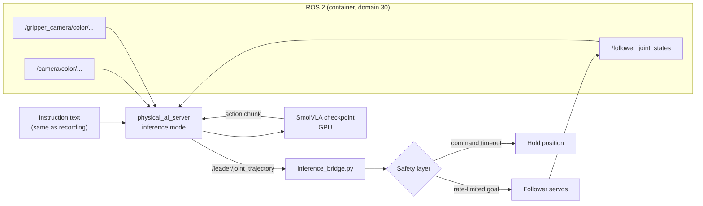

# Inference and Real-Robot Deployment

## Contents
- [Diagram F: inference pipeline](#diagram-f-inference-pipeline)
- [inference_bridge.py](#inference_bridgepy)
- [Running inference (web UI path)](#running-inference-web-ui-path)
- [Inference attempts and diagnoses](#inference-attempts-and-diagnoses)
- [Matching inference to training conditions](#matching-inference-to-training-conditions)
- [Host path: lerobot-rollout (planned)](#host-path-lerobot-rollout-planned)
- [Safety](#safety)

## Diagram F: inference pipeline



Note that `bridge.py` (teleoperation) is absent: during inference the policy, not the leader arm, publishes on `/leader/joint_trajectory`.

## inference_bridge.py

A custom ROS 2 node written for this project (version 2; source not yet included).

| Feature | Purpose |
|---------|---------|
| Subscribes to `/leader/joint_trajectory` | Receives the model's action targets |
| **Rate-limits the commanded goal**, not the measured position | Smooths motion without starving the arm of progress (the v1 bug) |
| Caps how far a goal may be from the current position | Prevents a single bad prediction from causing a large jump |
| Holds position when commands stop | Fails safe if the policy crashes or stalls |
| Dry-run mode | Logs what it would send without moving the arm |
| Publishes `/follower_joint_states` (assumed) | The policy needs state. Exactly which node publishes state during inference is not recorded |

### Why goal-based rate limiting matters

In v1, each new goal was limited to `measured_position ± 2 units`. Under gravity, the servos could not reach even that small step, so the measured position barely changed, the next goal was again only 2 units away, and the arm crept. The model therefore observed an arm that was not moving and kept producing "start of episode" actions. That is a closed-loop failure that offline evaluation could never reveal.

In v2 the limit is applied to the previous **commanded goal**: `goal_k = goal_{k-1} + clip(target − goal_{k−1}, −δ, +δ)`. The commanded trajectory therefore advances at the intended speed even when the servo lags, and a separate cap bounds `|goal − measured|`.

## Running inference (web UI path)

```bash
# [CONTAINER] terminal 1
~/start_cameras.sh
# [CONTAINER] terminal 2: make sure teleoperation is NOT running
pkill -f bridge.py || true
# [CONTAINER] terminal 2: dry run first, then live (argument names are illustrative)
python3 inference_bridge.py --dry-run
python3 inference_bridge.py
```

Then in the web UI (`http://localhost`): select the inference page, the checkpoint (`.../checkpoints/020000/pretrained_model` or `last`), the **same task instruction as in recording**, and an episode duration of **at least 20–30 s**.

## Inference attempts and diagnoses

| # | Observation | Diagnosis | Fix | Level |
|---|-------------|-----------|-----|-------|
| 1 | Arm did not move | `bridge.py` was still running; the follower obeyed the leader arm | Stop teleoperation before inference | ✅ Fixed |
| 2 | Arm hovered near rest, drifted toward the tray | Speed limit applied relative to **measured** position (2 units); servos lagged under gravity; the model saw a static arm | `inference_bridge.py` v2: limit relative to the commanded goal, plus a distance cap | ✅ Fixed |
| 3 | Arm reached out, positioned the gripper over the cube, hovered without grasping | Suspected distribution shift: extra red cubes in view, different gripper-camera colour (auto white balance), short inference episode | Match conditions (below), then re-test | 🟡 Superseded: a later run completed pick and place; what changed is not recorded |

Possible contributing factors for attempt 3 (🟡 hypotheses, not tested):

- **Open-loop chunks.** With `n_action_steps = 50` the robot executes up to 1.7 s of actions without looking. Grasping needs small corrections; a shorter execution horizon (for example 10–25) re-observes more often.
- **Limited training samples** (≈ 1.7 passes over the data in Run 1; see [smolvla-training.md](smolvla-training.md#how-much-data-did-the-model-actually-see)).
- **Rate limiting slows the closing phase.** If the gripper or descent is slowed by the bridge, the scene stops matching the demonstration timing.
- **Gripper action scale.** If gripper close values are clipped by the distance cap, the jaws may never close fully.

## Matching inference to training conditions

| Condition | During recording | Required at inference |
|-----------|------------------|-----------------------|
| Objects in scene | One red cube, one tray | **Remove extra cubes** |
| Cube position | Positions used in demonstrations | Start with a trained position |
| Gripper camera colour | Auto white balance (uncontrolled) | Lock WB; ideally re-record with the same locked value |
| Rest pose | Fixed rest pose | Same rest pose |
| Episode length | ≈ 20 s | ≥ 20–30 s |
| Instruction text | Fixed string | Identical string |
| Camera mounts | Fixed | Unchanged |

## Host path: lerobot-rollout (planned)

LeRobot 0.6.2 ships `lerobot-rollout` (installed and verified with `which`). The documented SmolVLA usage drives a `so101_follower` directly over serial with OpenCV cameras ([SmolVLA docs](https://huggingface.co/docs/lerobot/smolvla)). For this project:

- It bypasses ROS, so **every ROS bridge must be stopped** (one program per serial port).
- Camera names must match the training rename map (`camera1`, `camera2`), and the resolutions must match.
- The follower must be calibrated in LeRobot's own convention. If that differs from the units recorded through `bridge.py`, actions will be mis-scaled. **This is the biggest risk of the host path and is not verified.**

```bash
# [HOST] template only, not run; check `lerobot-rollout --help` for 0.6.2 flags
lerobot-rollout \
  --strategy.type=base \
  --robot.type=so101_follower \
  --robot.port=/dev/serial/by-id/<follower-adapter> \
  --robot.id=so101_follower \
  --robot.cameras="{ camera1: {type: opencv, index_or_path: /dev/v4l/by-id/<femto-colour>, width: 1280, height: 720, fps: 30}, camera2: {type: opencv, index_or_path: /dev/v4l/by-id/<gripper>, width: 640, height: 480, fps: 30}}" \
  --task="Move the SO-ARM101 follower arm to pick up an object from the starting position and place it at the target location. Perform the task smoothly and safely." \
  --policy.path=$HOME/so101_training/outputs/train/smolvla_so101_pick_place/checkpoints/last/pretrained_model
```

## Safety

1. Always do a **dry run** first and read the logged goals.
2. Keep a hand near the power switch, or have an e-stop, during the first live runs.
3. Clear the workspace of anything fragile; the arm can swing toward the tray unexpectedly (seen in attempt 2).
4. Never run teleoperation and inference at the same time.
5. Use conservative rate limits for the first runs; relax them only after behaviour looks sane.
