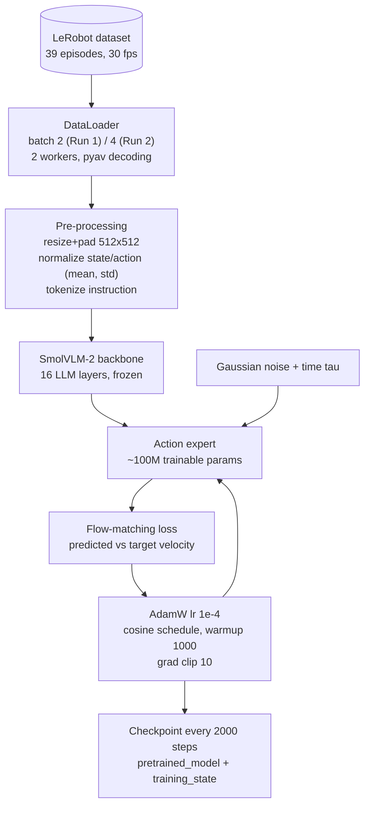

# SmolVLA Training and Checkpoint Management

## Contents
- [Overview of runs](#overview-of-runs)
- [Diagram E: training pipeline](#diagram-e-training-pipeline)
- [Run 1: container (complete)](#run-1-container-complete)
- [Run 2: host, LeRobot 0.6.2](#run-2-host-lerobot-062)
- [How much data did the model actually see?](#how-much-data-did-the-model-actually-see)
- [Learning-rate schedule note](#learning-rate-schedule-note)
- [Checkpoint management](#checkpoint-management)
- [Resuming training](#resuming-training)
- [Recovering from a corrupted checkpoint](#recovering-from-a-corrupted-checkpoint)
- [Memory on a 6 GB GPU](#memory-on-a-6-gb-gpu)

## Overview of runs

| | Run 1 | Run 2 |
|---|---|---|
| Environment | Physical AI Tools container | Host conda env, LeRobot 0.6.2 |
| Dataset | `NandithaaaG/s101_dataset_pick_and_place` (v2.1) | Same, converted to v3.0 locally |
| Initialization | ❌ Not verified (see note below) | `lerobot/smolvla_base` (reported) |
| Camera names | `global`, `gripper` (native) | `global → camera1`, `gripper → camera2`, + 1 empty camera |
| Batch size | 2 ✅ | 4 (reported) |
| Steps | 20,000 ✅ | 20,000 planned (reported) |
| Checkpoint every | 2,000 ✅ | 2,000 (reported) |
| Loss | ≈ 0.04 at end (reported) | ≈ 0.09 at step 7,500 (reported) |
| Status | ✅ Complete (`last -> 020000`) | ❓ Completion not verified |
| Output | `outputs/train/so101_pick_and_place_policy/` (container) | `~/so101_training/outputs/train/smolvla_so101_pick_place/` (host) |

> **Initialization of Run 1 is a key unknown.** The dumped config shows `load_vlm_weights: false`, `freeze_vision_encoder: true` and `train_expert_only: true`. If training started from `lerobot/smolvla_base`, the action expert began from community-pretrained weights. If it started from the plain policy type, the action expert was trained from scratch on 39 episodes. The SmolVLA paper reports that pretraining on community data raised the average real-world success from 51.7 % to 78.3 % on its SO-100 tasks ([paper summary](../research/paper-summaries/smolvla.md)), so this matters. Check: `grep -n pretrained_path .../checkpoints/last/pretrained_model/train_config.json`.

## Diagram E: training pipeline



The VLM is frozen and only the action expert (plus the state projection, `train_state_proj: true`) learns. That is why only 99.9M of 450M parameters are trainable (verified from the training log).

## Run 1: container (complete)

### Command used to resume (verified)

```bash
# [CONTAINER]
cd /root/ros2_ws/src/physical_ai_tools/lerobot
python -m lerobot.scripts.train \
  --config_path=outputs/train/so101_pick_and_place_policy/checkpoints/last/pretrained_model/train_config.json \
  --resume=true
```

The original command that started Run 1 from the web UI was not recorded.

### Configuration (verified from the `train_config.json` dump)

| Group | Setting | Value |
|-------|---------|-------|
| Run | `steps` / `batch_size` / `num_workers` / `seed` | 20,000 / 2 / 2 / 1000 |
| | `save_freq` / `log_freq` / `eval_freq` | 2,000 / 100 / 2,000 (no sim env, so no eval) |
| | `use_policy_training_preset` | true |
| Optimizer | type, lr, betas, eps, weight decay, grad clip | AdamW, 1e-4, (0.9, 0.95), 1e-8, 1e-10, 10.0 |
| Scheduler | type, warmup, decay steps, final lr | cosine decay with warmup, 1,000, 30,000, 2.5e-6 |
| Data | `video_backend`, image transforms | `pyav`, **disabled** |
| | `use_imagenet_stats` | true |
| Policy | `vlm_model_name` | `HuggingFaceTB/SmolVLM2-500M-Video-Instruct` |
| | `num_vlm_layers` | 16 |
| | `freeze_vision_encoder` / `train_expert_only` / `train_state_proj` | true / true / true |
| | `attention_mode` / `self_attn_every_n_layers` | `cross_attn` / 2 |
| | `expert_width_multiplier` | 0.75 |
| | `chunk_size` / `n_action_steps` / `n_obs_steps` | 50 / 50 / 1 |
| | `num_steps` (flow-matching integration steps) | 10 |
| | `resize_imgs_with_padding` | [512, 512] |
| | `max_state_dim` / `max_action_dim` | 32 / 32 (6-D values are zero-padded) |
| | `tokenizer_max_length` / `pad_language_to` | 48 / `longest` |
| | Normalization | state and action: MEAN_STD; images: IDENTITY |
| | `use_amp` | false |
| | `empty_cameras` | 0 |
| | `device` | cuda |
| Logging | W&B | disabled |

A JSON reconstruction is in [experiments/training-configs/run1_container_train_config.json](../experiments/training-configs/run1_container_train_config.json).

### Timeline (from checkpoint timestamps, 17 Oct)

| Checkpoint | Time | Interval | Notes |
|------------|------|----------|-------|
| 002000 | 11:27 | — | |
| 004000 | 11:39 | 12 min | ≈ 0.36 s/step |
| 006000 | 11:51 | 12 min | Last intact checkpoint before the power cut |
| 008000 | 12:46 | — | Re-written after resuming from 006000 (the original 008000 had 0-byte files) |
| 010000 | 13:03 | 17 min | Original target; then extended |
| 012000 | 14:21 | — | Gap includes the extension restart |
| 014000–020000 | 15:12 → 15:47 | ≈ 12 min each | ≈ 0.35 s/step |

## Run 2: host, LeRobot 0.6.2

### Command (🔧 reconstructed; replace with the exact command from `history`)

```bash
# [HOST] reconstructed from the reported settings; verify every flag with `lerobot-train --help`
conda activate lerobot
lerobot-train \
  --policy.path=lerobot/smolvla_base \
  --dataset.repo_id=NandithaaaG/s101_dataset_pick_and_place \
  --dataset.root=<path-to-local-v3.0-copy> \
  --rename_map='{"observation.images.global": "observation.images.camera1", "observation.images.gripper": "observation.images.camera2"}' \
  --policy.empty_cameras=1 \
  --batch_size=4 \
  --steps=20000 \
  --save_freq=2000 \
  --output_dir=$HOME/so101_training/outputs/train/smolvla_so101_pick_place \
  --job_name=smolvla_so101_pick_place \
  --policy.device=cuda \
  --policy.push_to_hub=false \
  --wandb.enable=false
```

Why the rename map: `smolvla_base` was pretrained with standardized camera slots (`camera1` top, `camera2` wrist, `camera3` side; see the SmolVLA paper's "camera viewpoint normalization"). Mapping the scene camera to `camera1` and the gripper camera to `camera2` reuses what the base model learned about those slots. See [LeRobot: Using Rename Map and Empty Cameras](https://huggingface.co/docs/lerobot/rename_map).

### Reported progress

| Metric | Value |
|--------|-------|
| Speed | ≈ 0.53 s/step at batch 4 |
| GPU memory | ≈ 2.5 GB |
| Loss at step 7,500 | ≈ 0.09 |
| Expected duration | ≈ 3 h for 20,000 steps |

### Check whether it finished

```bash
# [HOST]
ls -l ~/so101_training/outputs/train/smolvla_so101_pick_place/checkpoints/
# expect: 002000 ... 020000 and last -> 020000
```

## How much data did the model actually see?

A useful sanity check is **samples seen ÷ dataset frames**:

| Run | Batch × steps | Samples seen | Passes over 23,424 frames |
|-----|---------------|--------------|---------------------------|
| Run 1 | 2 × 20,000 | 40,000 | ≈ 1.7 |
| Run 2 | 4 × 20,000 | 80,000 | ≈ 3.4 |
| SmolVLA docs example | 64 × 20,000 | 1,280,000 | ≈ 55 |

Each sample is a frame plus the next 50 actions, so consecutive samples overlap heavily. Even so, Runs 1 and 2 used **16–32× fewer samples** than the official example configuration. A low training loss does not contradict this: the loss is averaged over noisy flow-matching targets and dominated by the many "easy" frames (reaching, transporting), while the few frames around the grasp carry most of the precision requirement. **Interpretation, not yet tested:** under-training on grasp frames may contribute to the "hover over the cube" behaviour. Experiments to test this are in [limitations-and-future-work.md](limitations-and-future-work.md).

## Learning-rate schedule note

Run 1 used `num_decay_steps = 30,000` with `steps = 20,000`. If the scheduler is applied literally, the cosine schedule is only two-thirds complete at the end of training, and the final learning rate is roughly 2.7 × 10⁻⁵ rather than the configured floor of 2.5 × 10⁻⁶. Some LeRobot versions rescale the schedule automatically when `steps < num_decay_steps`; whether the container version does is **not verified**. Check the `lr` value printed in the training log near step 20,000.

## Checkpoint management

Layout of each checkpoint (verified for Run 1: each step directory contains two subdirectories):

```text
checkpoints/
├── 002000/
│   ├── pretrained_model/      # config.json, model weights, train_config.json
│   └── training_state/        # optimizer, scheduler, RNG state, step counter
├── ...
├── 020000/
└── last -> 020000             # symlink used by --resume
```

| Practice | Why |
|----------|-----|
| Keep `pretrained_model/` for every checkpoint you might evaluate | Lets you compare 10k vs 20k on the robot |
| `training_state/` is only needed to resume; delete it from old checkpoints to save disk | Optimizer state is about 2× the trainable parameters |
| Never commit checkpoints to Git | Use the Hub (`hf upload`) or local backups; `.gitignore` blocks weights |
| Verify integrity after any crash | A power cut left 0-byte files in `008000` |

Integrity check (also used on 20 Oct):

```bash
# [CONTAINER]
ls -lah outputs/train/so101_pick_and_place_policy/checkpoints/020000/pretrained_model/
find outputs/train/so101_pick_and_place_policy/checkpoints/020000 -size 0   # must print nothing
```

## Resuming training

`--resume=true` continues from `checkpoints/last`, restoring the optimizer, scheduler and step counter. Resuming a run whose step counter already equals `steps` does nothing; that is the expected behaviour verified on 20 Oct:

```text
INFO ... cfg.steps=20000 (20K)
INFO ... Start offline training on a fixed dataset
INFO ... End of training
```

To **extend** a finished run, raise `steps` (for example `--steps=30000`) when resuming. Extending changes where the run sits on the learning-rate schedule. With only 39 episodes, consider first whether more data would help more than more steps.

## Recovering from a corrupted checkpoint

What happened in Run 1 (reported): power was lost while `008000` was being written, leaving 0-byte files, and the web UI could not resume because of a page-side path check. Recovery steps (🔧 reconstructed procedure):

```bash
# [CONTAINER]
cd /root/ros2_ws/src/physical_ai_tools/lerobot/outputs/train/so101_pick_and_place_policy/checkpoints
find 008000 -size 0                     # confirm the damage
mv 008000 ../008000_corrupt_backup      # keep it out of the way, don't delete yet
ln -sfn 006000 last                     # point "last" at the last intact checkpoint
cd /root/ros2_ws/src/physical_ai_tools/lerobot
python -m lerobot.scripts.train \
  --config_path=outputs/train/so101_pick_and_place_policy/checkpoints/last/pretrained_model/train_config.json \
  --resume=true
```

## Memory on a 6 GB GPU

| Lever | Effect | Used here |
|-------|--------|-----------|
| Freeze VLM, train expert only | Optimizer state only for ~100M params | ✅ (default for SmolVLA) |
| Small batch (2–4) | Fits in ≈ 2.5 GB | ✅ |
| Mixed precision (`use_amp`) | Less memory, faster | ❌ (`use_amp: false` in Run 1) |
| Gradient accumulation | Larger effective batch without more memory | ❌ Not used; check support in your LeRobot version |
| LoRA / PEFT | Even fewer trainable parameters | ❌ Not used; LeRobot documents PEFT training |

Background: [learning/training-and-fine-tuning.md](../learning/training-and-fine-tuning.md).
