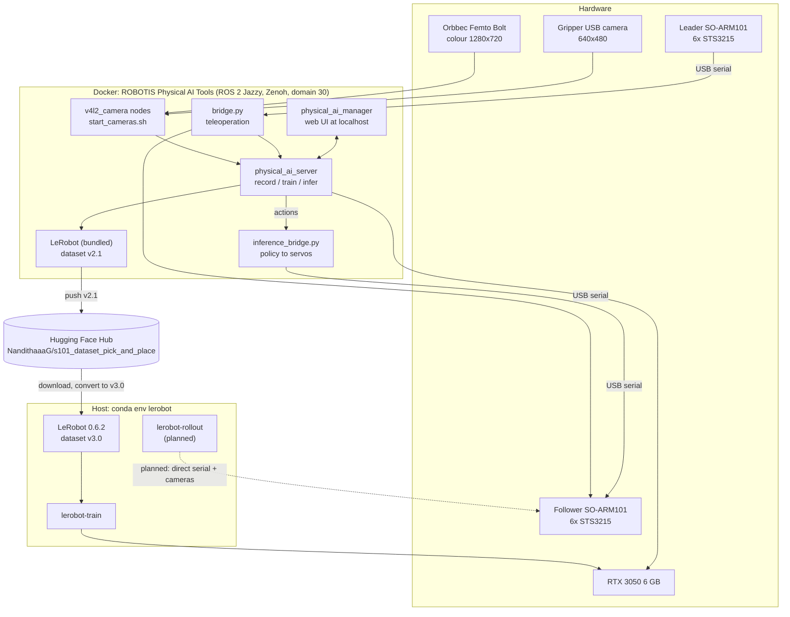
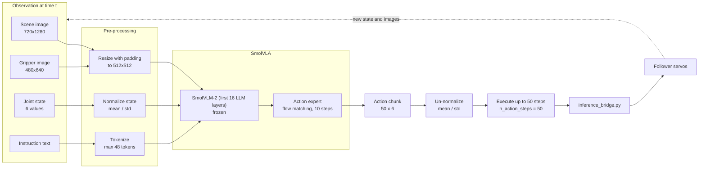
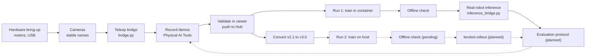

# System Architecture

## Contents
- [Two software stacks](#two-software-stacks)
- [ROS 2 interface](#ros-2-interface)
- [Diagram A: overall system](#diagram-a-overall-system)
- [Diagram B: camera → policy → robot data flow](#diagram-b-camera--policy--robot-data-flow)
- [Diagram G: end-to-end project workflow](#diagram-g-end-to-end-project-workflow)
- [Other diagrams](#other-diagrams)
- [Design decisions](#design-decisions)

## Two software stacks

The project uses two separate environments on the same PC. Keeping them separate matters because they use **different LeRobot versions and different dataset formats**.

| | A. Physical AI stack (Docker) | B. Host LeRobot stack (conda) |
|---|---|---|
| Purpose | Recording, Run 1 training, web-UI inference | Run 2 training with current LeRobot; planned `lerobot-rollout` |
| Entry point | `~/lerobot/physical_ai_tools/docker/container.sh enter` | `conda activate lerobot` |
| Containers / tools | `physical_ai_server`, `physical_ai_manager` (web UI), `open_manipulator` | `lerobot-train`, `lerobot-rollout` |
| Middleware | ROS 2 Jazzy, `rmw_zenoh_cpp`, `ROS_DOMAIN_ID=30` | None |
| LeRobot | Version bundled with Physical AI Tools (exact version not recorded) | 0.6.2 |
| Dataset format | v2.1 | v3.0 |
| Training output | `/root/ros2_ws/src/physical_ai_tools/lerobot/outputs/train/so101_pick_and_place_policy/` | `~/so101_training/outputs/train/smolvla_so101_pick_place/` |

The container's `rmw_zenoh_cpp` default is announced by the container banner ("Since v1.0.0, rmw_zenoh_cpp is the default RMW"), and `RMW_IMPLEMENTATION` is set in the container's `~/.bashrc`.

## ROS 2 interface

Defined in the Physical AI Tools robot configuration `s101_dataset_config.yaml`:

| Role | Topic | Message type | Publisher |
|------|-------|--------------|-----------|
| Scene image | `/camera/color/image_raw/compressed` | `sensor_msgs/CompressedImage` | `v4l2_camera` (Femto Bolt) |
| Gripper image | `/gripper_camera/color/image_raw/compressed` | `sensor_msgs/CompressedImage` | `v4l2_camera` (gripper camera) |
| State | `/follower_joint_states` | `sensor_msgs/JointState` | `bridge.py` (teleop) |
| Action | `/leader/joint_trajectory` | `trajectory_msgs/JointTrajectory` | `bridge.py` during recording; the **policy** during inference |

The action topic does double duty. During recording it carries the human's leader commands; during inference the policy publishes on it, and `inference_bridge.py` consumes it. That is why `bridge.py` must be stopped before inference (see [troubleshooting](troubleshooting.md#t9-model-runs-but-the-arm-does-not-move)).

## Diagram A: overall system

**How to read it.** Everything that touches ROS runs in Docker. The host environment only trains (and, in future, may run `lerobot-rollout`, which talks to the arm over serial directly and so must never run at the same time as the ROS bridges). The Hub is the hand-off point between the two LeRobot versions.

## Diagram B: camera → policy → robot data flow

The settings in this diagram (512×512 resize with padding, 16 VLM layers, 10 flow-matching steps, chunk size 50, `n_action_steps` 50, mean/std normalization, tokenizer max length 48) come from the verified Run 1 `train_config.json`. With `n_action_steps = 50` the robot executes up to 50 actions (about 1.7 s at 30 fps) before the policy sees a new observation; see [learning/action-chunking.md](../learning/action-chunking.md) for why that matters for grasping.

## Diagram G: end-to-end project workflow

Dashed arrows are planned or unverified steps. The loop from evaluation back to recording is the expected improvement cycle: evaluation reveals failure modes, which guide what extra demonstrations to record.

## Other diagrams

| Diagram | Location |
|---------|----------|
| C. Leader–follower teleoperation | [teleoperation.md](teleoperation.md#diagram-c-leaderfollower-teleoperation) |
| D. Dataset recording pipeline | [dataset-recording.md](dataset-recording.md#diagram-d-recording-pipeline) |
| E. SmolVLA training pipeline | [smolvla-training.md](smolvla-training.md#diagram-e-training-pipeline) |
| F. Inference pipeline | [inference.md](inference.md#diagram-f-inference-pipeline) |

Mermaid sources for all diagrams are in [architecture/](../architecture/).

## Design decisions

| Decision | Reason | Trade-off |
|----------|--------|-----------|
| Custom `bridge.py` instead of LeRobot's built-in teleop loop | Physical AI Tools records from ROS topics, so the arms had to be exposed as ROS topics | An extra component to maintain; must be stopped for inference |
| A separate `inference_bridge.py` | The policy publishes target trajectories; something must turn them into safe servo goals | Its rate limiting changes the closed-loop dynamics (see attempt 2) |
| Keep the v2.1 dataset on the Hub, convert locally for the host | The container's LeRobot still reads v2.1 | Two copies to keep in sync |
| Map camera names to SmolVLA's `camera1` / `camera2` and add one empty camera (Run 2) | `smolvla_base` was pretrained with three standardized camera slots | Must use the same mapping at inference |
