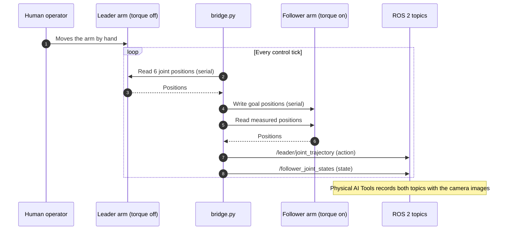

# Leader–Follower Teleoperation

## Contents
- [Concept](#concept)
- [Diagram C: leader–follower teleoperation](#diagram-c-leaderfollower-teleoperation)
- [bridge.py responsibilities](#bridgepy-responsibilities)
- [Running teleoperation](#running-teleoperation)
- [Operating rules](#operating-rules)
- [Status](#status)

## Concept

In leader–follower (puppeteering) teleoperation, a person moves a passive **leader** arm by hand, and a powered **follower** arm with the same kinematics copies its joint angles. Because both arms share the same joint layout, the leader's joint angles can be used directly as the follower's targets, with no inverse kinematics. The same idea underlies ALOHA and the SO-100/101 kits ([Zhao et al., 2023](../research/paper-summaries/act.md)). Theory: [learning/robot-teleoperation.md](../learning/robot-teleoperation.md).

For learning, what matters is the distinction between:

- **action** = what the operator *commanded* (the leader's joints), and
- **state** = what the follower *actually did* (its measured joints).

The policy is trained to predict the action given the observations, so at inference time it acts like the operator.

## Diagram C: leader–follower teleoperation



## bridge.py responsibilities

`bridge.py` is a custom ROS 2 node written for this project (verified working; source not yet included in this repository).

| Responsibility | Detail |
|----------------|--------|
| Read leader | Six joint positions from the leader's Feetech bus (board `5B14111828`) |
| Command follower | Writes the same positions as goals to the follower's bus (board `5A7C120749`) |
| Publish action | `trajectory_msgs/JointTrajectory` on `/leader/joint_trajectory` |
| Publish state | `sensor_msgs/JointState` on `/follower_joint_states` |
| Joint names | `shoulder_pan, shoulder_lift, elbow_flex, wrist_flex, wrist_roll, gripper` |

The control rate of `bridge.py` was not recorded. The dataset itself is sampled at 30 fps by the recorder.

## Running teleoperation

```bash
# [CONTAINER] terminal 1: cameras
~/start_cameras.sh

# [CONTAINER] terminal 2: teleoperation bridge
python3 bridge.py           # path and arguments depend on where the script is stored

# [CONTAINER] terminal 3: confirm topics
ros2 topic hz /follower_joint_states
ros2 topic echo --once /leader/joint_trajectory
```

## Operating rules

1. **Exactly one process per serial port.** Stop `bridge.py` before running calibration, `inference_bridge.py` or `lerobot-rollout`.
2. **Start from the same rest pose every episode.** The policy learns the starting configuration; inference must start there too.
3. **Move smoothly and consistently.** Hesitations, re-grasps and different strategies across demonstrations make the action distribution multi-modal, which is harder to learn from 39 episodes (see [learning/imitation-learning-and-behavioral-cloning.md](../learning/imitation-learning-and-behavioral-cloning.md)).
4. **Watch the follower, not the leader.** The follower lags under gravity; demonstrations look better when the operator corrects for what the follower actually does.

## Status

| Item | Level |
|------|-------|
| Mirroring leader → follower | ✅ Tested |
| State and action topics recorded correctly ("state follows action" in the viewer) | ✅ Verified on the 21-episode dataset |
| Teleoperation latency / control rate measured | ❌ Not measured |
