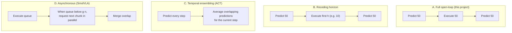

# Action Chunking and Temporal Action Prediction

## Contents
- [Introduction](#introduction)
- [Why it matters here](#why-it-matters-here)
- [Single-step vs chunked policies](#single-step-vs-chunked-policies)
- [Execution strategies](#execution-strategies)
- [Asynchronous inference (SmolVLA)](#asynchronous-inference-smolvla)
- [Connection to this project](#connection-to-this-project)
- [Limitations](#limitations)
- [Lessons](#lessons)
- [Further reading](#further-reading)

## Introduction

An **action chunk** is a sequence of *k* future actions predicted from a single observation: π(*ot*) → (*at*, *at+1*, …, *at+k−1*). Action chunking was introduced to robot learning by ACT ([Zhao et al., 2023](../research/paper-summaries/act.md)) and is now used by Diffusion Policy, π0 and SmolVLA.

## Why it matters here

SmolVLA in this project predicts **50 actions per inference** (`chunk_size: 50`) and executes **all 50** before observing again (`n_action_steps: 50`). At 30 fps, that is about 1.7 s of motion without feedback. How chunks are executed directly affects grasp precision.

## Single-step vs chunked policies

| | Single-step | Chunked (*k* steps) |
|---|---|---|
| Decisions per episode of *T* steps | *T* | *T*/*k* |
| Compounding error | Each step can drift | Fewer decision points; ACT argues this reduces the effective horizon |
| Temporal consistency | Each action predicted independently | Actions within a chunk are coherent (smooth trajectories) |
| Handling pauses in demos | Ambiguous (a "pause" state has many possible next actions) | The chunk encodes the whole motion, so pauses are less confusing |
| Reactivity | Re-observes every step | Open-loop within a chunk unless re-planned |

ACT's authors reported that chunking substantially improved success on their fine manipulation tasks, and that **temporal ensembling** further smoothed motion.

## Execution strategies

**Temporal ensembling (ACT).** At each step, all chunks that cover the current time step contribute a prediction, combined with exponential weights *wi* = exp(−*m*·*i*), where *i* indexes predictions from oldest to newest. It needs a forward pass every step.

**Receding horizon.** Execute only the first *h* actions of each chunk, then re-plan. Smaller *h* means more reactivity and more compute. In LeRobot this is the `n_action_steps` parameter.

## Asynchronous inference (SmolVLA)

SmolVLA's paper adds an asynchronous stack: a robot client keeps executing its action queue while a policy server computes the next chunk from a fresh observation. A new chunk is requested when the remaining fraction of the queue drops below a threshold *g* ∈ [0, 1], and overlapping actions are merged. The authors derive that idle gaps are avoided when

$$
g \ge \frac{\mathbb{E}[\ell_S] / \Delta t}{n}
$$

where ℓS is inference latency, Δ*t* the control period (33 ms at 30 fps), and *n* the chunk size. On their real pick-and-place evaluation, async inference completed tasks in about 9.7 s on average versus 13.75 s for synchronous execution, at a similar success rate ([SmolVLA paper](../research/paper-summaries/smolvla.md)).

## Connection to this project

| Setting | Value | Consequence |
|---------|-------|-------------|
| `chunk_size` | 50 | ≈ 1.7 s of predicted motion per inference |
| `n_action_steps` | 50 | Full open-loop execution of each chunk (strategy A) |
| Inference mode | Synchronous (web UI) | The arm may pause while the next chunk is computed |
| `inference_bridge.py` rate limit | Slows execution | Real execution takes longer than 1.7 s per chunk, so the observation used for the next chunk is older relative to the plan |

**Interpretation (untested):** During the final approach, a 1.7 s open-loop chunk computed while the gripper was still a few centimetres away cannot correct small misalignment. Reducing `n_action_steps` to 10–25 at inference (strategy B) is a low-cost experiment; the SmolVLA paper also ablates how many actions to execute before updating the observation.

## Limitations

Long chunks trade reactivity for smoothness; short chunks trade smoothness and compute for reactivity. There is no universally best setting. It depends on latency, task precision and control frequency.

## Lessons

1. `chunk_size` (what the model predicts) and `n_action_steps` (what the robot executes) are different knobs; the second can be changed at inference without retraining.
2. Any controller wrapper that changes execution speed also changes how stale the next observation is.

## Further reading

- Zhao, T. Z. et al. (2023). ACT. arXiv:2304.13705. Sections on action chunking and temporal ensembling.
- Shukor, M. et al. (2025). SmolVLA. arXiv:2506.01844. Section 3.3, asynchronous inference.
- [LeRobot: Use Async Inference](https://huggingface.co/docs/lerobot/async), and [Real-Time Chunking](https://huggingface.co/docs/lerobot/rtc).
