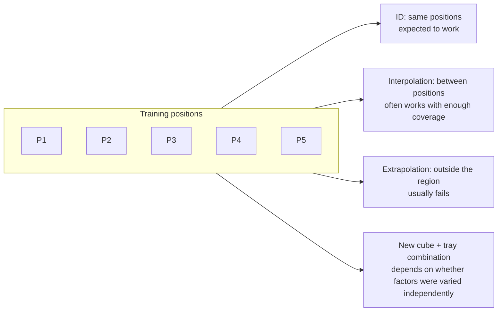

# Dataset Design, Data Quality and Generalization

## Contents
- [Introduction](#introduction)
- [Why it matters here](#why-it-matters-here)
- [Quantity, quality and diversity](#quantity-quality-and-diversity)
- [What the research found](#what-the-research-found)
- [Generalization to unseen object and target positions](#generalization-to-unseen-object-and-target-positions)
- [Overfitting in behavioral cloning](#overfitting-in-behavioral-cloning)
- [A recording plan for this project](#a-recording-plan-for-this-project)
- [Limitations](#limitations)
- [Lessons](#lessons)
- [Further reading](#further-reading)

## Introduction

In imitation learning, the dataset defines the task. The policy can only reproduce behaviour it has seen, in conditions resembling those it has seen. Designing the dataset (how many demonstrations, of what, under which variations) is therefore the main lever a practitioner controls.

## Why it matters here

The project dataset has 39 episodes, one instruction, uncontrolled gripper-camera colour, and unlogged cube positions. Each of these choices limits what can be learned and what can be evaluated.

## Quantity, quality and diversity

| Axis | Question | Status in this dataset |
|------|----------|------------------------|
| **Quantity** | Enough episodes per variation? | 39 total; per-position count unknown |
| **Quality** | Successful, smooth, consistent demonstrations? | Not systematically audited |
| **Diversity** | Do the variations cover the test conditions? | Cube positions varied (extent unknown); tray position not logged |
| **Consistency** | Same lighting, camera settings, start pose? | Start pose consistent (reported); camera colour not |
| **Labels** | Task text accurate? | One fixed instruction |

## What the research found

**SmolVLA guidance (official docs).** The LeRobot SmolVLA guide recommends about 50 episodes as a starting point and stresses having enough demonstrations *per variation*. Its reference pick-place dataset used 5 cube positions × 10 episodes, and the authors note that a 25-episode version performed badly ([SmolVLA docs](https://huggingface.co/docs/lerobot/smolvla)). The paper's real-world datasets follow the same 5 × 10 design ([paper summary](../research/paper-summaries/smolvla.md)).

**Data scaling laws (Lin et al., ICLR 2025).** Using a hand-held gripper, the authors collected over 40,000 demonstrations and ran more than 15,000 real-robot rollouts. They found that generalization to new environments and objects follows roughly a power law in the number of **environments and objects**, and that adding more demonstrations within the same environment gives diminishing returns. Their practical conclusion is to prioritize diversity over repetition once each condition has a modest number of demonstrations ([summary](../research/paper-summaries/evaluation-and-data-scaling.md)).

**robomimic (Mandlekar et al., CoRL 2021).** In a systematic study of offline human demonstrations, data collected by more proficient operators and of more consistent quality led to substantially better policies than mixed-quality data. Operator skill and consistency matter as much as volume.

**Pretraining helps small datasets.** In the SmolVLA paper, pretraining on community datasets raised the average real-world success on their SO-100 tasks from 51.7 % to 78.3 % compared with training without robot pretraining. Starting from `smolvla_base` is the most data-efficient option available to this project.

## Generalization to unseen object and target positions

Behavioral cloning generalizes best by **interpolating** between demonstrated conditions. Extrapolating to positions outside the demonstrated region is much harder. In the SmolVLA paper's SO-101 experiment, success dropped from 90 % in distribution to 50 % with the object in novel positions, still better than ACT (70 % → 40 %). Even a pretrained VLA loses a lot of performance out of distribution.

For **target** (tray) positions, the same logic applies: if the tray never moved in the demonstrations, the policy has no reason to look for it, and it will place at the remembered location.

## Overfitting in behavioral cloning

With 39 episodes, a ~100M-parameter action expert can memorize trajectories. Signs:

- very low training loss, but behaviour that replays a stereotyped trajectory regardless of where the cube is;
- good offline error on training episodes, worse on held-out episodes.

Mitigations: hold out episodes to measure offline error; use augmentation; keep the VLM frozen (already the default); choose the checkpoint by robot evaluation, not by loss; add data diversity.

**Note:** in robot BC, more training steps beyond the loss plateau sometimes improves real-world smoothness even when validation loss rises, so the final checkpoint should be chosen by **task success**, not by loss alone. This is a common practitioner observation, not a law.

## A recording plan for this project

| Factor | Values | Episodes |
|--------|--------|----------|
| Cube position | 5 marked positions on a grid | 4 each = 20 new episodes |
| Tray position | Fixed (phase 1); 2–3 positions (phase 2) | — |
| Camera settings | Locked WB and exposure, written down | All |
| Distractors | None (phase 1) | — |
| Log | Position ID per episode in a CSV | All |

Combined with the existing 39, this gives ~60 episodes with a known position structure, enabling in- and out-of-distribution tests ([evaluation protocol](../docs/evaluation.md)).

## Limitations

Scaling-law results come from different robots, tasks and data-collection methods; their exact exponents do not transfer. The direction of the finding (diversity over repetition) is what is useful here.

## Lessons

1. Log the variations (cube and tray positions) at recording time; you cannot reconstruct them reliably later.
2. Ten demonstrations per condition is a reasonable floor for a small VLA fine-tune.
3. Distractors and colour variation are variations too. Either exclude them at test time or include them in training.

## Further reading

- Lin, F. et al. (2025). *Data Scaling Laws in Imitation Learning for Robotic Manipulation.* ICLR. arXiv:2410.18647.
- Mandlekar, A. et al. (2021). *What Matters in Learning from Offline Human Demonstrations for Robot Manipulation.* CoRL. arXiv:2108.03298.
- [LeRobot SmolVLA guide](https://huggingface.co/docs/lerobot/smolvla), "Collect a dataset".
