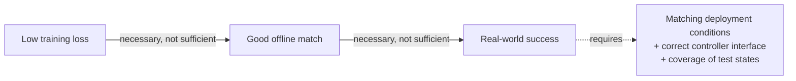

# Evaluating Robot Manipulation Policies

## Contents
- [Introduction](#introduction)
- [Why it matters here](#why-it-matters-here)
- [Training loss vs task success](#training-loss-vs-task-success)
- [Offline metrics](#offline-metrics)
- [Online (real-robot) metrics](#online-real-robot-metrics)
- [Best practices from the literature](#best-practices-from-the-literature)
- [Statistics for small trial counts](#statistics-for-small-trial-counts)
- [Applying this to the project](#applying-this-to-the-project)
- [Further reading](#further-reading)

## Introduction

Robot policies are ultimately judged by what they do on a robot. Real-world trials are slow and expensive, so evaluation needs a protocol: fixed conditions, multiple metrics, enough trials, and honest uncertainty.

## Why it matters here

The project has a low training loss and a good offline match, yet no successful grasp on the robot. Separating these kinds of evidence is the whole point of this guide.

## Training loss vs task success

| Quantity | What it measures | What it cannot tell you |
|----------|------------------|------------------------|
| Training loss (flow matching, ≈ 0.04 in Run 1) | How well the expert predicts the noise-to-action velocity on training samples | Anything about states the policy visits by itself |
| Offline action error (2–5 units on episode 0) | Open-loop agreement with a recorded trajectory | Compounding errors, controller effects, visual shift |
| Real-world success rate | Whether the task is done | *Why* it failed, unless failure modes are logged |

Every link in that chain failed at least once in this project: offline match was good, but the controller wrapper (attempt 2) and the visual conditions (attempt 3) broke the last link.

## Offline metrics

- **Per-joint MAE / RMSE** between predicted and recorded actions, on **held-out** episodes.
- **Phase-wise error:** error during reach, grasp, transport and place separately. The grasp phase usually matters most.
- **Gripper timing error:** frame difference between predicted and recorded gripper closing.

Offline metrics are cheap and catch pipeline bugs (wrong normalization statistics, swapped cameras, wrong checkpoint). They do not predict real-world success reliably.

## Online (real-robot) metrics

| Metric | Type |
|--------|------|
| Success rate (full task) | Binary per trial |
| Partial credit (e.g. 0.5 grasp + 0.5 place, as in the SmolVLA paper) | Graded |
| Completion time | Continuous, successes only |
| Drops, collisions, safety stops | Counts |
| Recovery behaviour | Binary / count |
| Failure mode | Categorical |

## Best practices from the literature

Kress-Gazit et al. (2024, *Robot Learning as an Empirical Science*, arXiv:2409.09491) argue that reporting a single success rate is not enough to compare policies on physical robots. Their recommendations, in our words:

1. **Report the experimental conditions explicitly**: initial states, objects, lighting, and how trials were reset.
2. **Use several metrics** that complement success rate (for example task progress, time, and failure categories).
3. **Apply statistical analysis** rather than comparing raw percentages.
4. **Describe failure modes qualitatively**, because how a policy fails says a lot about what to fix.

Statistical comparison methods tailored to robotics also exist, such as sequential tests that stop as soon as the evidence is sufficient (STEP, arXiv:2503.10966).

## Statistics for small trial counts

For *k* successes in *n* trials, the **Wilson score interval** is preferred over the naive ±1.96√(p(1−p)/n), which misbehaves near 0 % and 100 %:

$$
\frac{\hat p + \frac{z^2}{2n} \pm z\sqrt{\frac{\hat p(1-\hat p)}{n} + \frac{z^2}{4n^2}}}{1 + \frac{z^2}{n}}
$$

| Result | 95 % Wilson interval |
|--------|---------------------|
| 0 / 10 | 0 % – 28 % |
| 5 / 10 | 24 % – 76 % |
| 9 / 10 | 60 % – 98 % |
| 18 / 20 | 70 % – 97 % |

Ten trials can separate "works" from "doesn't work", but not 60 % from 80 %.

## Applying this to the project

- The protocol in [docs/evaluation.md](../docs/evaluation.md) implements these practices: fixed and logged conditions, ID/OOD position sets, partial credit, failure taxonomy, Wilson intervals.
- Current measured state: **0 protocol trials run**. The three informal attempts are reported as qualitative observations only.

## Further reading

- Kress-Gazit, H. et al. (2024). *Robot Learning as an Empirical Science: Best Practices for Policy Evaluation.* arXiv:2409.09491.
- STEP: *Is Your Imitation Learning Policy Better than Mine? Policy Comparison with Near-Optimal Stopping.* arXiv:2503.10966.
- Shukor, M. et al. (2025). SmolVLA, §4.1 (evaluation metrics with partial credit).
