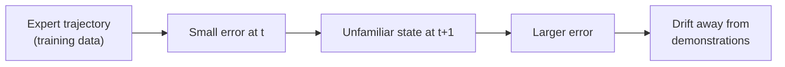

# Imitation Learning and Behavioral Cloning

## Contents
- [Introduction](#introduction)
- [Why it matters here](#why-it-matters-here)
- [Behavioral cloning as supervised learning](#behavioral-cloning-as-supervised-learning)
- [Covariate shift and compounding errors](#covariate-shift-and-compounding-errors)
- [Remedies](#remedies)
- [Multimodal demonstrations](#multimodal-demonstrations)
- [Key papers](#key-papers)
- [Connection to this project](#connection-to-this-project)
- [Limitations](#limitations)
- [Lessons](#lessons)
- [Further reading](#further-reading)

## Introduction

**Imitation learning (IL)** learns a policy from expert demonstrations instead of from a reward signal. Its simplest and most widely used form is **behavioral cloning (BC)**: treat each (observation, expert action) pair as a supervised training example. The idea is old. ALVINN learned to steer a vehicle from camera images and a human driver's steering in the late 1980s ([Pomerleau, 1988](../research/references.bib)). Today almost every VLA, including SmolVLA, is trained with a form of behavioral cloning.

## Why it matters here

The whole project is behavioral cloning: 39 teleoperated demonstrations → SmolVLA learns to output the operator's actions given what the robot sees. Both the strengths (no reward engineering) and the classic weakness (compounding errors) show up in the results.

## Behavioral cloning as supervised learning

Given a dataset 𝒟 = {(*oi*, *ai*)} of observations and expert actions, BC fits a policy πθ by maximum likelihood:

$$
\theta^\* = \arg\max_\theta \sum_{(o,a)\in\mathcal{D}} \log \pi_\theta(a \mid o)
$$

With a Gaussian policy of fixed variance this reduces to mean-squared-error regression, ‖πθ(*o*) − *a*‖². SmolVLA instead uses a **flow-matching** objective (a generative model of the action distribution; see [SmolVLA architecture](smolvla-architecture.md)). It is still behavioral cloning: the target is always the demonstrated action.

## Covariate shift and compounding errors

BC trains on states the **expert** visited, but at test time the policy visits states produced by **its own** actions. A small error moves the robot slightly off the expert's path, into states seen rarely or never in training, where errors are larger, and so on.

Ross and Bagnell analysed this formally: under BC, if the per-step error on the expert's distribution is ε, the expected total cost over a horizon *T* can grow as **O(*T*² ε)**, quadratically rather than linearly in the horizon ([Ross & Bagnell, 2010](../research/references.bib); [Ross et al., 2011](../research/references.bib)).

## Remedies

| Remedy | Idea | Used here? |
|--------|------|-----------|
| **DAgger** (Ross et al., 2011) | Run the learned policy, have the expert label the states it visits, add them to the data, retrain. Reduces the error bound to roughly linear in *T* | ❌ (could be done with the leader arm: take over when the policy fails) |
| More diverse data | Demonstrations from more start states cover more of the state space | Partly (39 episodes) |
| Recovery demonstrations | Deliberately show how to recover from mistakes (e.g. re-grasp) | ❌ |
| **Action chunking** (Zhao et al., 2023) | Predict several future actions at once, reducing the effective number of decisions | ✅ chunk size 50 ([guide](action-chunking.md)) |
| Noise injection during collection | Perturb the expert so the data contain corrections | ❌ |
| Pretraining | Start from a model that has seen many trajectories | ✅ in Run 2 (`smolvla_base`); unverified for Run 1 |

## Multimodal demonstrations

If the operator sometimes approaches the cube from the left and sometimes from the right, the "average" action points straight at the obstacle in between. MSE regression learns that average. Generative action models (the CVAE in ACT, diffusion in Diffusion Policy, flow matching in π0 and SmolVLA) can represent several modes ([Chi et al., 2023](../research/paper-summaries/diffusion-policy.md)). For a small dataset, the cheapest fix is still **consistent demonstrations**.

## Key papers

| Paper | Contribution relevant here |
|-------|---------------------------|
| Pomerleau (1988), ALVINN | Early end-to-end behavioral cloning from camera images |
| Ross & Bagnell (2010); Ross, Gordon & Bagnell (2011), DAgger | Formalized compounding error; proposed interactive data aggregation |
| Mandlekar et al. (2021), robomimic | Systematic study of learning from offline human demonstrations: demonstration quality and operator proficiency strongly affect results |
| Zhao et al. (2023), ACT | Action chunking to reduce compounding error |
| Chi et al. (2023), Diffusion Policy | Expressive generative policies for multimodal action distributions |

## Connection to this project

- **What the papers predict:** a BC policy that fits its training data well (offline error 2–5 units) can still drift on the real robot, especially in phases with little data or high precision (the grasp).
- **What was observed:** attempt 3 reached the cube but did not close the gripper. That fits the pattern, but the causes are not proven (see [inference.md](../docs/inference.md)).
- **Interpretation:** a cheap DAgger-style loop is available, because the leader arm can take over whenever the policy hesitates. Those corrective segments could be recorded as new episodes.

## Limitations

BC cannot exceed the demonstrator, cannot learn what was never shown, and inherits operator inconsistencies. It also optimizes action error, not task success, which is why [evaluation](evaluation-metrics.md) must be done on the robot.

## Lessons

1. Low training loss is necessary but not sufficient.
2. The grasp is a small fraction of each episode but carries most of the precision; it deserves deliberate coverage.
3. A leader–follower setup makes interactive correction (DAgger-like) practical.

## Further reading

- Ross, S., Gordon, G., Bagnell, J. A. (2011). *A Reduction of Imitation Learning and Structured Prediction to No-Regret Online Learning.* AISTATS. arXiv:1011.0686.
- Mandlekar, A. et al. (2021). *What Matters in Learning from Offline Human Demonstrations for Robot Manipulation.* CoRL. arXiv:2108.03298.
- Zhao, T. Z. et al. (2023). ACT. arXiv:2304.13705.
