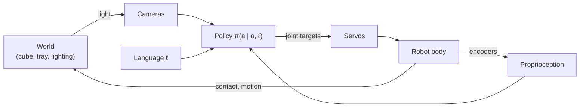

# Physical AI and Embodied Intelligence

## Contents
- [Introduction](#introduction)
- [Why it matters here](#why-it-matters-here)
- [Core concepts](#core-concepts)
- [The perception–action loop](#the-perceptionaction-loop)
- [From hand-engineered pipelines to learned policies](#from-hand-engineered-pipelines-to-learned-policies)
- [Sim-to-real, and why this project skipped simulation](#sim-to-real-and-why-this-project-skipped-simulation)
- [Terminology](#terminology)
- [Limitations](#limitations)
- [Lessons from this project](#lessons-from-this-project)
- [Further reading](#further-reading)

## Introduction

**Physical AI** is an industry term for AI systems that perceive and act in the physical world: robots, autonomous vehicles, drones. **Embodied intelligence** is the older research idea underneath it: intelligence arises from an agent's interaction with its environment through a body, not from symbol manipulation alone. Rodney Brooks argued in 1991 that useful robot behaviour could be built from tight sensing–acting loops without a central world model ([Brooks, 1991](../research/references.bib)). Pfeifer and Bongard later developed the view that body morphology and environment shape what an agent can learn ([Pfeifer & Bongard, 2006](../research/references.bib)).

Modern physical AI combines that embodied perspective with large pretrained models. A vision-language model already "knows" what a cube and a tray look like from web data; robot learning teaches it how a particular body moves to act on that knowledge.

## Why it matters here

The project is a minimal physical-AI system: two cameras (perception), a language instruction (goal), joint encoders (proprioception), six servos (actuation), and a learned policy that closes the loop 30 times per second. Most of the problems encountered (servo lag under gravity, camera colour drift, USB resets) are *physical*. A purely digital AI system never meets them.

## Core concepts

| Concept | Meaning | In this project |
|---------|---------|-----------------|
| Embodiment | The agent's body determines what actions exist | 6-DoF arm with a parallel gripper; actions are 6 joint targets |
| Proprioception | Sensing the body's own configuration | `observation.state`: follower joint positions |
| Exteroception | Sensing the environment | Scene camera + gripper camera |
| Closed loop | Actions change future observations | The policy sees the result of its own previous actions |
| Partial observability | Sensors don't capture everything | The scene camera cannot resolve grasp alignment at mm scale; the gripper camera helps |
| Non-stationarity | The world changes between training and deployment | Lighting, white balance, distractor cubes |

## The perception–action loop

Formally, at each time step *t* the agent receives an observation *ot* (images + state), a goal *ℓ* (the instruction), and outputs an action *at* ~ π(· | *ot*, *ℓ*). The environment then transitions to a new state that depends on *at*. Because future observations depend on past actions, errors **compound**. This is the central difficulty of learning control from demonstrations (see [imitation learning](imitation-learning-and-behavioral-cloning.md)).

## From hand-engineered pipelines to learned policies

| Classical pipeline | Learned (end-to-end) policy |
|--------------------|----------------------------|
| Detect the cube (vision) → estimate its 3-D pose (calibration) → plan a grasp → solve inverse kinematics → plan a trajectory → execute | Images + state + text → neural network → joint targets |
| Each module engineered and tuned separately | One model trained from demonstrations |
| Explicit coordinate frames, calibrated cameras | Coordinate relationships learned implicitly |
| Fails when a module's assumptions break | Fails when test data differ from training data |

This project uses the learned approach. That is why it needs no camera calibration or inverse kinematics, but it is also why it is sensitive to distribution shift.

## Sim-to-real, and why this project skipped simulation

**Sim-to-real transfer** trains a policy in simulation and deploys it on a real robot. The gap between simulated and real physics and rendering is bridged with techniques such as **domain randomization**: randomizing textures, lighting and camera poses in simulation so that the real world looks like just another variation ([Tobin et al., 2017](../research/references.bib)).

This project trained **only on real data**, which is the norm for low-cost leader–follower arms: collecting 39 real demonstrations took less effort than building an accurate simulation of the SO-ARM101, its servos and the cameras. The idea behind domain randomization still applies, though. Randomizing colour and brightness during training (image augmentation) is the real-data analogue, and it would have helped with the white-balance problem seen in inference attempt 3 (*interpretation*).

## Terminology

- **Policy:** a function from observations (and goal) to actions.
- **Degrees of freedom (DoF):** independent joints; the SO-ARM101 has 5 arm joints + 1 gripper.
- **Control frequency:** how often actions are sent (here, data are recorded at 30 Hz).
- **Distribution shift:** test-time inputs that differ from the training distribution.

## Limitations

"Physical AI" is used loosely in industry and has no single formal definition. The embodied-cognition literature is broad and partly philosophical; this guide uses only its most practical point, that perception and action must be studied together.

## Lessons from this project

1. The hardest bugs were physical (USB power, servo lag, camera defaults), not algorithmic.
2. Closing the loop on a real robot exposed a controller bug (rate limiting relative to the measured position) that no offline metric could reveal.
3. A learned policy inherits every regularity of its training environment, including lighting and clutter.

## Further reading

- Brooks, R. A. (1991). *Intelligence without representation.* Artificial Intelligence 47.
- Pfeifer, R. & Bongard, J. (2006). *How the Body Shapes the Way We Think.* MIT Press.
- Tobin, J. et al. (2017). *Domain Randomization for Transferring Deep Neural Networks from Simulation to the Real World.* IROS. arXiv:1703.06907.
- Cadene, R. et al. (2026). *LeRobot: An Open-Source Library for End-to-End Robot Learning.* ICLR. arXiv:2602.22818. Its introduction gives a good overview of how robot learning differs from classical robotics.
