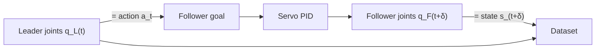

# Robot Teleoperation, State and Actions

## Contents
- [Introduction](#introduction)
- [Why it matters here](#why-it-matters-here)
- [Teleoperation interfaces](#teleoperation-interfaces)
- [Joint space, state and action](#joint-space-state-and-action)
- [Why action ≠ next state](#why-action--next-state)
- [Position control on hobby servos](#position-control-on-hobby-servos)
- [What makes a good demonstration](#what-makes-a-good-demonstration)
- [Terminology](#terminology)
- [Lessons from this project](#lessons-from-this-project)
- [Further reading](#further-reading)

## Introduction

To imitate a human, a robot needs recordings of the human performing the task *through the robot's own body*. **Teleoperation** provides this: a person controls the robot remotely, and both the commands and the resulting sensor data are logged.

## Why it matters here

Every training sample in this project was produced by leader–follower teleoperation. The quality, consistency and diversity of those demonstrations set the upper bound on what SmolVLA can learn.

## Teleoperation interfaces

| Interface | How it works | Pros | Cons |
|-----------|--------------|------|------|
| **Leader–follower (puppeteering)** | Operator moves a kinematically identical arm; the follower copies its joints | Intuitive, cheap, no inverse kinematics, natural motions | Needs a second arm; no force feedback in the SO-ARM kits |
| Spacemouse / gamepad | Operator commands end-effector velocity | Single arm | Unnatural, slow for complex motions |
| VR controllers | Hand pose mapped to end-effector pose | Intuitive 6-DoF | Needs IK; latency; tracking noise |
| Hand-held grippers (e.g. UMI) | Human uses a gripper with a camera; no robot during collection | Very scalable | Embodiment gap at deployment |

ALOHA popularized low-cost leader–follower teleoperation for fine bimanual manipulation and showed it could produce data good enough for precise learned policies ([Zhao et al., 2023](../research/paper-summaries/act.md)). The SO-100/101 kits bring the same idea to a single low-cost arm and are integrated into LeRobot ([Cadene et al., 2026](../research/paper-summaries/lerobot.md)).

## Joint space, state and action

The SO-ARM101 has six joints. Both state and action live in this 6-dimensional **joint space**:

- **state** *st* ∈ ℝ⁶: the follower's *measured* joint positions at time *t* (`observation.state`);
- **action** *at* ∈ ℝ⁶: the *commanded* joint targets at time *t*, which come from the leader (`action`).

The policy learns *p*(*at*, …, *at+n* | imagest, *st*, instruction).

## Why action ≠ next state

If the follower tracked perfectly, `action(t) == state(t+1)`. In reality:

- servos have finite speed and stiffness, so the follower **lags** the leader;
- gravity pulls the arm down, so the follower settles slightly **below** the commanded position (steady-state error);
- contact (gripping the cube) stops the gripper before its commanded position.

The last point matters most for grasping. When the gripper closes on the cube, the *action* says "close to X" but the *state* stops at the cube's width. The policy has to learn to command *past* contact to produce grip force. This is why training on **actions** (leader) rather than **states** (follower) is the correct choice, and it is what this dataset does.

In this project the "state follows action" relationship was checked in the dataset viewer and looked as expected.

## Position control on hobby servos

Feetech STS3215 servos run an internal position loop: you send a goal position, and the servo drives toward it. Consequences:

1. **Rate limiting the goal** is the safe way to smooth motion (see `inference_bridge.py` v2).
2. **Rate limiting relative to the measured position** couples the command to the lag. Under gravity the arm then barely moves. This was the bug in inference attempt 2.
3. Command rate matters less than **goal consistency**: the servo smooths between goals.

## What makes a good demonstration

| Property | Why |
|----------|-----|
| Consistent strategy | One way to approach, grasp and place makes the action distribution unimodal and easier to fit |
| Smooth, unhurried motion | Jerky demos teach jerky actions; very fast ones are hard for the follower to track |
| Same start and end pose | Gives the policy a consistent anchor |
| Successful outcome | Failed or corrected demos teach failure unless deliberately labelled |
| Coverage of variations | Several demos per cube position (see [dataset design](dataset-design-and-generalization.md)) |

## Terminology

- **Teleoperation:** human control of a robot from a distance or through an interface.
- **Kinematic correspondence:** leader and follower share the same joint structure, so joint angles map one to one.
- **Steady-state error:** the residual difference between goal and measured position after settling.

## Lessons from this project

1. Exactly one process may own each serial port; teleoperation and inference must never run together.
2. Gravity-induced lag is enough to break a controller wrapper that reasons about measured positions.
3. The distinction between commanded and measured joints is not a detail: it is what lets the policy learn to grip.

## Further reading

- Zhao, T. Z. et al. (2023). *Learning Fine-Grained Bimanual Manipulation with Low-Cost Hardware.* RSS. arXiv:2304.13705.
- [LeRobot SO-101 documentation](https://huggingface.co/docs/lerobot/so101): calibration and teleoperation with native LeRobot tools.
- Lin, F. et al. (2025). *Data Scaling Laws in Imitation Learning for Robotic Manipulation.* ICLR. arXiv:2410.18647. Uses a hand-held gripper (UMI) for scalable collection.
