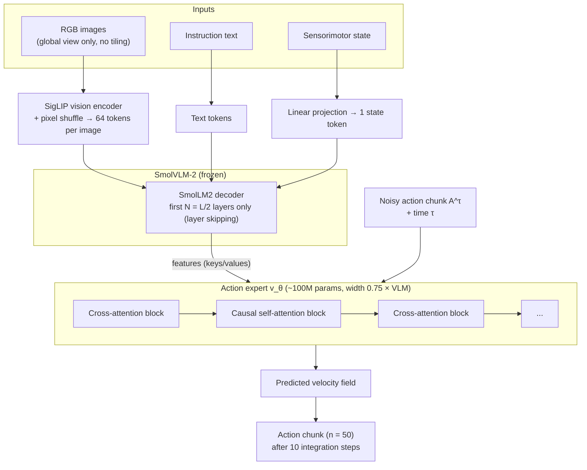

# SmolVLA Architecture

## Contents
- [Introduction](#introduction)
- [Why it matters here](#why-it-matters-here)
- [Architecture diagram](#architecture-diagram)
- [Component by component](#component-by-component)
- [Flow matching, step by step](#flow-matching-step-by-step)
- [Pretraining on community data](#pretraining-on-community-data)
- [Key results reported in the paper](#key-results-reported-in-the-paper)
- [Mapping paper → this project's config](#mapping-paper--this-projects-config)
- [Limitations](#limitations)
- [Further reading](#further-reading)

## Introduction

SmolVLA (Shukor et al., 2025, arXiv:2506.01844, Hugging Face / Sorbonne / valeo.ai / ENS Paris-Saclay) is a ~450M-parameter VLA designed to be trained on a single GPU and run on consumer hardware. It is a preprint; the summary below is our own reading of it.

## Why it matters here

It is the model fine-tuned in both training runs. Every hyperparameter in the Run 1 config has a counterpart in the paper.

## Architecture diagram

## Component by component

| Component | Paper design | Why |
|-----------|--------------|-----|
| **Backbone VLM** | SmolVLM-2 (SigLIP vision encoder + SmolLM2 language decoder) | Small, efficient, multi-image capable |
| **Visual tokens** | Global image only, no tiling; pixel shuffle → **64 tokens per frame** | Speed |
| **Layer skipping** | Use features from the first *N* = *L*/2 LLM layers; discard the rest | Roughly halves VLM compute; the paper's ablation found that skipping layers of a larger VLM worked better than using a smaller VLM |
| **State** | Projected to a single token by a linear layer, fed to the VLM | Proprioception enters the shared context |
| **Action expert** | Transformer with hidden size 0.75 × VLM width, ~100M params | Generates continuous action chunks |
| **Attention pattern** | **Interleaved** blocks: cross-attention (action tokens attend to VLM features) alternating with **causal** self-attention (action tokens attend to earlier action tokens) | Ablations: interleaving beat pure CA or pure SA; causal masking beat bidirectional |
| **Training objective** | Conditional flow matching | Continuous, multimodal action distributions |
| **Output** | Chunk of *n* = 50 actions | Action chunking |
| **Training regime** | VLM frozen; only the action expert trained | Cheap fine-tuning |

## Flow matching, step by step

Flow matching ([Lipman et al., 2023](../research/references.bib)) trains a network to predict a **velocity field** that transports noise to data. SmolVLA follows π0's formulation.

1. Take a demonstrated action chunk **A**t (50 × action dim) and Gaussian noise ε ~ 𝒩(0, I).
2. Sample a time τ ∈ [0, 1] (from a Beta distribution, as in π0) and form the interpolation **A**τ = τ **A**t + (1 − τ) ε.
3. The target velocity along this straight path is **u** = ε − **A**t (the paper's sign convention).
4. Train the expert **v**θ(**A**τ, **o**t) to predict **u**:

$$
\mathcal{L}(\theta) = \mathbb{E}\left[\left\| \mathbf{v}_\theta(\mathbf{A}^\tau_t, \mathbf{o}_t) - (\boldsymbol\epsilon - \mathbf{A}_t) \right\|^2\right]
$$

5. **At inference**, start from pure noise and integrate the predicted velocity field in a fixed number of Euler steps (10 in SmolVLA, `num_steps: 10` in the config) to obtain an action chunk.

The "loss ≈ 0.04" in Run 1 is this velocity-regression loss on normalized actions. It is not an action error in joint units, so it cannot be compared directly with the 2–5-unit offline error.

## Pretraining on community data

| Item | Paper value |
|------|-------------|
| Datasets | 481 community datasets from the Hugging Face Hub |
| Episodes / frames | ~22.9k episodes, ~10.6M frames |
| Task-text cleanup | Instructions re-annotated with an off-the-shelf VLM (Qwen2.5-VL-3B) |
| Camera normalization | Views manually mapped to standardized slots (top, wrist, side → image 1, 2, 3) |
| Pretraining | 200k steps, global batch 256, cosine LR 1e-4 → 2.5e-6, AdamW (0.9, 0.95), 512×512 images |
| Compute | About 30k GPU-hours for the whole project, as reported |

The **camera normalization** is why Run 2 renamed `global → camera1` and `gripper → camera2` and added one empty camera.

## Key results reported in the paper

- **Simulation:** with 0.45B parameters, SmolVLA reached 87.3 % average on LIBERO and 57.3 % on Meta-World, competitive with π0 (3.3B) and above OpenVLA (7B) and Octo on LIBERO, as reported in its Table 2.
- **Real world, SO-100 (pick-place, stacking, sorting):** 78.3 % average vs 61.7 % for π0 and 48.3 % for ACT.
- **Real world, SO-101 Lego pick-place:** 90 % in distribution, 50 % out of distribution (ACT: 70 % / 40 %).
- **Pretraining effect:** 51.7 % → 78.3 % average with community pretraining.
- **Async inference:** ~30 % faster task completion at similar success.

These are the authors' results under their protocols, not results reproduced in this project.

## Mapping paper → this project's config

| Paper concept | Run 1 config key | Value |
|---------------|------------------|-------|
| SmolVLM-2 backbone | `vlm_model_name` | `HuggingFaceTB/SmolVLM2-500M-Video-Instruct` |
| Layer skipping (first 16 layers) | `num_vlm_layers` | 16 |
| Expert width 0.75 × | `expert_width_multiplier` | 0.75 |
| Interleaved CA/SA | `attention_mode`, `self_attn_every_n_layers` | `cross_attn`, 2 |
| Chunk size *n* | `chunk_size` | 50 |
| Flow-matching steps | `num_steps` | 10 |
| Frozen VLM, train expert | `freeze_vision_encoder`, `train_expert_only` | true, true |
| 512×512 images | `resize_imgs_with_padding` | [512, 512] |
| Optimizer | `optimizer_*` | AdamW, lr 1e-4, betas (0.9, 0.95) |
| Schedule | `scheduler_*` | warmup 1000, decay 30000 → 2.5e-6 |
| Total / trainable params | training log | 450.0M / 99.9M |

## Limitations

The paper's real-world datasets use 50 demonstrations (5 positions × 10) per task and fine-tune for many more samples than this project. Its benchmark conditions (lighting, cameras, objects) are controlled. The authors also list limitations of their own, such as the limited diversity of community data and the cost of real-world evaluation.

## Further reading

- Shukor, M. et al. (2025). *SmolVLA.* arXiv:2506.01844. Sections 3 (architecture) and 4.7 (ablations).
- Black, K. et al. (2024). *π0.* arXiv:2410.24164. The flow-matching action expert SmolVLA builds on.
- Lipman, Y. et al. (2023). *Flow Matching for Generative Modeling.* ICLR. arXiv:2210.02747.
- Marafioti, A. et al. (2025). *SmolVLM.* arXiv:2504.05299.
- [LeRobot SmolVLA documentation](https://huggingface.co/docs/lerobot/smolvla).
