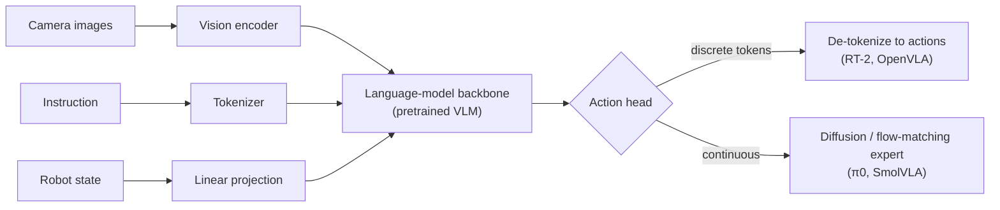

# Vision-Language-Action Models

## Contents
- [Introduction](#introduction)
- [Why it matters here](#why-it-matters-here)
- [Generic VLA architecture](#generic-vla-architecture)
- [How VLAs evolved](#how-vlas-evolved)
- [Discrete tokens vs continuous action experts](#discrete-tokens-vs-continuous-action-experts)
- [The LeRobot ecosystem](#the-lerobot-ecosystem)
- [Where SmolVLA sits](#where-smolvla-sits)
- [Limitations of VLAs](#limitations-of-vlas)
- [Further reading](#further-reading)

## Introduction

A **vision-language-action (VLA) model** is a robot policy built on a vision-language model (VLM). It takes camera images, a natural-language instruction and usually the robot's proprioceptive state, and outputs robot actions. The motivation: VLMs trained on internet-scale image–text data already understand objects, spatial relations and instructions; robot data then only needs to teach the mapping to motion.

## Why it matters here

SmolVLA is a VLA. Understanding the family explains SmolVLA's design choices (small VLM, continuous action expert, action chunks) and what can and cannot be expected from fine-tuning it on 39 demonstrations.

## Generic VLA architecture

## How VLAs evolved

| Model (year, venue) | Key idea | Size | Data |
|---------------------|----------|------|------|
| **RT-1** (2022 preprint; RSS 2023) | Transformer that maps images + instruction to **discretized** actions; trained from scratch on a large real-robot dataset | ~35M | ~130k real episodes, 700+ tasks, 13 robots of one type |
| **RT-2** (CoRL 2023) | Co-fine-tunes a large web-pretrained VLM to output actions **as text tokens**; shows transfer of web knowledge (e.g. semantic reasoning) to robot control | Up to 55B | RT-1 robot data + web VLM data |
| **Open X-Embodiment / RT-X** (2023; ICRA 2024) | Pools data from many labs and robot types (22 embodiments) into one dataset; shows positive transfer across robots | — | 1M+ trajectories |
| **Octo** (RSS 2024) | Open generalist transformer policy with a diffusion action head; trained on Open X-Embodiment; designed for fine-tuning | 27M / 93M | ~800k trajectories |
| **OpenVLA** (CoRL 2024) | Open-source 7B VLA (Llama 2 + DINOv2/SigLIP features), discrete action tokens; reports LoRA fine-tuning on consumer GPUs | 7B | ~970k Open X episodes |
| **π0** (2024 preprint) | VLM (PaliGemma) + a separate **flow-matching action expert** producing continuous action chunks at high frequency | 3.3B | ~10k hours of cross-embodiment data |
| **SmolVLA** (2025 preprint) | Small VLM (SmolVLM-2), layer skipping, few visual tokens, interleaved cross/self-attention flow-matching expert; pretrained on community data; async inference | 0.45B | 481 community datasets, ~23k episodes |

Sizes and data figures are as reported by the respective papers; see [research/paper-summaries](../research/paper-summaries/) and [research-comparison.md](../research/research-comparison.md).

## Discrete tokens vs continuous action experts

| | Discrete action tokens (RT-1, RT-2, OpenVLA) | Continuous action expert (π0, SmolVLA) |
|---|---|---|
| Action representation | Each dimension binned (e.g. 256 bins) and emitted as a token | Real-valued vectors generated by diffusion or flow matching |
| Reuse of LM machinery | High (next-token prediction) | Needs an extra module |
| Precision | Limited by bin width | Continuous |
| Speed | Autoregressive, one token per dimension per step | Whole chunk generated in a fixed number of denoising steps (10 in SmolVLA) |
| Multimodality | Handled by the token distribution | Handled by the generative model |

The SmolVLA paper notes that tokenization limits continuous control, which motivates diffusion- and flow-based decoders.

## The LeRobot ecosystem

LeRobot is Hugging Face's open-source library for end-to-end robot learning. Its ICLR 2026 paper describes it as covering the whole stack: hardware interfaces for low-cost robots (including SO-100/101), a standardized dataset format (LeRobotDataset) stored on the Hugging Face Hub, implementations of many policies (ACT, Diffusion Policy, π0, SmolVLA and others), training and evaluation scripts, and an asynchronous inference stack ([summary](../research/paper-summaries/lerobot.md)).

In this project LeRobot appears twice: as the version bundled inside ROBOTIS Physical AI Tools (dataset v2.1), and as LeRobot 0.6.2 on the host (dataset v3.0).

## Where SmolVLA sits

SmolVLA trades raw capacity for accessibility. According to its paper it matches or beats much larger VLAs on the LIBERO and Meta-World benchmarks and on the authors' SO-100 real-world tasks, while being trainable on a single GPU. Its pretraining data comes from the same kind of low-cost arms used here. Details: [SmolVLA architecture](smolvla-architecture.md).

## Limitations of VLAs

- **Language grounding needs language diversity.** With one instruction, the language pathway contributes little; the policy is effectively visuomotor.
- **Pretraining is not magic.** The SmolVLA paper's out-of-distribution SO-101 result (50 %) shows large drops away from demonstrated conditions.
- **Embodiment specifics** (calibration, units, camera placement) must still match between fine-tuning and deployment.
- **Inference cost** matters for control; large VLAs need quantization, remote servers or asynchronous execution.

## Further reading

- Brohan, A. et al. (2023). *RT-1.* RSS. arXiv:2212.06817.
- Zitkovich, B., Yu, T. et al. (2023). *RT-2.* CoRL, PMLR 229. arXiv:2307.15818.
- Open X-Embodiment Collaboration (2024). ICRA. arXiv:2310.08864.
- Octo Model Team (2024). *Octo.* RSS. arXiv:2405.12213.
- Kim, M. J. et al. (2024). *OpenVLA.* CoRL. arXiv:2406.09246.
- Black, K. et al. (2024). *π0.* arXiv:2410.24164.
- Shukor, M. et al. (2025). *SmolVLA.* arXiv:2506.01844.
